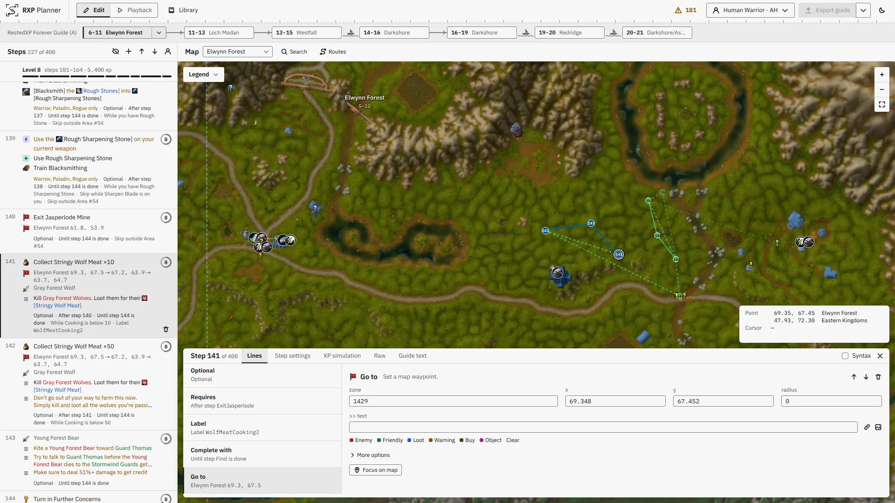
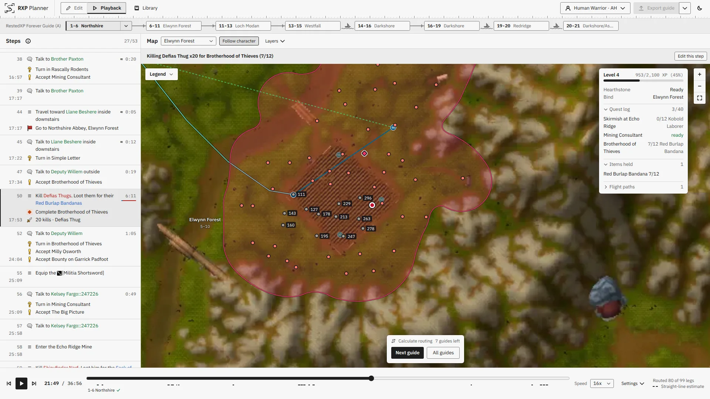
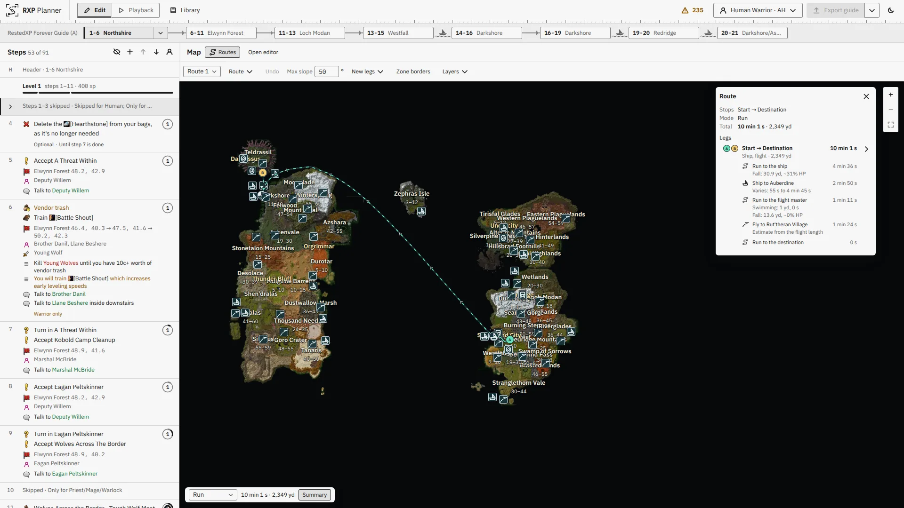

# RXP Planner

RXP Planner builds [RestedXP](https://www.restedxp.com/) leveling
guides for World of Warcraft: Forever. It routes each step on the game's
terrain as you write, plays the guide back as a character on the map, and
exports the guide as an addon that RestedXP Guides loads in game.

<table>
  <tr>
    <td colspan="2" align="center">
      <a href="docs/images/editor.webp"></a><br>
      Editor
    </td>
  </tr>
  <tr>
    <td width="50%" align="center">
      <a href="docs/images/playback.webp"></a><br>
      Playback
    </td>
    <td width="50%" align="center">
      <a href="docs/images/routing.webp"></a><br>
      Routing
    </td>
  </tr>
</table>

Open the planner at <https://rxp-planner.quest>.

> [!NOTE]
> RXP Planner is an independent project and is not affiliated with RestedXP.

## Features

- **Built-in guides.** Start from the RestedXP Forever guides. Your first
  edit to one makes your own copy.
- **Import and export.** Import addons, Lua files, or guide text. Export a
  zip file that holds an addon for RestedXP Guides.
- **Real-time routing.** Ground routes on the game's terrain, with ships,
  zeppelins, and flight paths. Move a stop, and the route updates.
- **Character preview.** Choose the race, the class, the start guide, and
  the start level. The step list shows the steps that apply, the level at
  each step, and the route warnings.
- **Playback.** The character follows the route on the map, with the time,
  the XP, the quest log, and the kills at each step.
- **Leveling simulation.** An estimate of the XP, the kills, and the play
  time of each step, and of the time to each level.
- **Agent tools.** An AI agent can read the quest data and write, check,
  and time guides. `pnpm --silent agent:mcp` serves the tools over MCP.

## How the data works

The planner reads game data, such as quests, NPCs, and map coordinates, from
a dataset. Routing reads a routing artifact for each map, with the walkable
terrain and the floors of its buildings and caves. A separate data producer
publishes both in one release file, and `scripts/dataset/pin.json` pins that
file by its SHA-256 hash. The planner refuses any file that does not match
the dataset's manifest. The [data contract](docs/reference/data-contract.md)
defines the format.

## Building from source

### Requirements

- The Node.js version that `package.json` requires in `engines`
- The pnpm version that `package.json` pins
- `tar`

### Run locally

```sh
pnpm install
pnpm data:install
pnpm dev
```

To try the planner without the release file, run
`RXP_DATASET=data/fixtures/generic-dataset pnpm dev`. This small sample
dataset is enough to write, import, and export guides, but no map has routes.

### Install the release file

| Command                    | What it does                                                                                                         |
| -------------------------- | -------------------------------------------------------------------------------------------------------------------- |
| `pnpm data:install`        | Downloads the pinned release file and installs it in `.local-data/`.                                                 |
| `pnpm data:install FILE`   | Installs a local copy of the release file.                                                                           |
| `pnpm data:validate`       | Checks the installed dataset.                                                                                        |
| `RXP_DATASET=DIR pnpm dev` | Uses another dataset folder. A relative path starts at the repository root. Routing still comes from `.local-data/`. |

The installer refuses a file whose hash does not match the pin, before it
unpacks anything. A failed download or a refused file leaves `.local-data/`
as it was.

### Fix common problems

- **The dataset is missing or fails its checks.** `pnpm dev` still starts,
  so you can edit and save guides. `pnpm build` fails.
- **A map has no routes.** `pnpm dev` and `pnpm build` print a warning for
  each map whose routing artifact is missing or fails its checks. They print
  no warning when `.local-data/bundle.json` is missing, and then no map has
  routes.
- **An install stopped before it finished.** It can leave folders named
  `.local-data.new-*`. If `.local-data/` is missing, run `pnpm data:install`
  again. Then delete the `.local-data.new-*` folders.

## Credits

- **Guides.** The built-in guides are the Forever guides from
  [RestedXP Guides](https://github.com/RestedXP/RXPGuides), under
  [CC BY-NC-SA 4.0](https://creativecommons.org/licenses/by-nc-sa/4.0/).
  The same terms cover the packed copy that the app ships. See
  [`guides/rxp-forever/`](guides/rxp-forever/README.md). Thanks to the
  RestedXP project for the addon and the guides.
- **Game data.** The app loads its quest data, routing data, and map art
  from the [dataset release](https://github.com/kevhardy/rxp-planner/releases).
  Parts of that data come from these projects:
  - [Questie](https://github.com/Questie/Questie) and
    [QuestieDB](https://github.com/Questie/QuestieDB), under GPL-3.0
  - [CMaNGOS classic-db](https://github.com/cmangos/classic-db), under GPL-3.0
  - [Mapzeroth](https://github.com/tr0tsky0/Mapzeroth), under MIT

  Each release holds a `NOTICE` that credits each project, and the full
  license texts.

- **XP rules.** Researched on [Warcraft Wiki](https://warcraft.wiki.gg).
- **Trademarks.** World of Warcraft and its content and art belong to
  Blizzard Entertainment, Inc.

## License

The code is under the [GNU Affero General Public License v3.0 or later](LICENSE).
The built-in guides in [`guides/rxp-forever/`](guides/rxp-forever/README.md)
and their packed copy, `public/data/rxp-forever.json.gz`, are under
[CC BY-NC-SA 4.0](https://creativecommons.org/licenses/by-nc-sa/4.0/). The
game data has its own licenses, which [Credits](#credits) lists.
